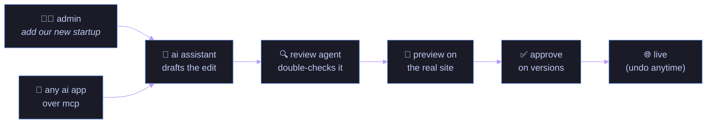

### hey, i'm sanjay 👋

ai & data science student at iiit kottayam. i do **edge ai**: shrinking models until they run on a phone or a raspberry pi, no cloud needed. mostly so they can **hear** (speech recognition for indian languages) and **see** (medical imaging).

#### `❯ cat ~/.interests`

```diff
+ edge ai: models that run on the device, offline, fast
+ speech / asr: hinglish and code-switching, the way india actually talks
+ medical imaging on cheap hardware: screening that works without a lab
+ agents that do real work instead of just chatting
- sending your voice or your scans to someone else's server
```

#### `❯ cat ~/shipped/aic.md`

> **[aic iiit kottayam](https://github.com/Chai-Coders/AIC)**, a real product for a real client (our incubation centre).
>
> we took their plain old website and turned it into a whole thing: a fresh redesign, a cms so the team can change anything without touching code, and then **an ai that manages the website for them**. type *"add our new startup, here's the logo"* and it drafts the change, a second agent reviews it, and you see it on the actual site before anything goes live. any ai app (claude, etc.) can plug in over **mcp** too. nothing ships until a human clicks approve, and every change can be undone.



<sub>`react` · `django → convex` · `gemini / claude` · `mcp` · `33 end-to-end tests` · built with the [chai-coders](https://github.com/Chai-Coders) crew</sub>

#### `❯ ls ~/projects --sort=pride`

| | | |
|---|---|---|
| 🗣️ | [**`bolo/`**](https://github.com/Sanjay-Sunil/Bolo) | a voice assistant that gets hinglish. speech-to-text and voice run on the phone, and it replies in ~2s. [apk](https://github.com/Sanjay-Sunil/Bolo/releases/latest) |
| 🇮🇳 | [**`itantra-stt/`**](https://github.com/Sanjay-Sunil/itantra-stt) | speech-to-text for 10 indian languages, even when you switch mid-sentence. no internet needed. [try it in your browser](https://huggingface.co/spaces/zxnjxd/itantra-stt-browser) |
| 🎙️ | [**`hinglish-tts/`**](https://github.com/Sanjay-Sunil/finetuned-tts) | taught an english tts model to speak hinglish. [before vs after](https://huggingface.co/spaces/zxnjxd/hinglish-pocket-tts) (the before is funny) |
| 🩺 | **`otoscope-edge/`** | reads otoscope (ear) images: 5 efficientnets voting, 98.5% macro f1, running on a raspberry pi |
| 📲 | [**`autopilot/`**](https://github.com/Sanjay-Sunil/AutoPilot) | text your laptop from your phone and an agent does the thing. encrypted, with a kill switch just in case |
| 🩹 | [**`autoheal.ai/`**](https://github.com/Chai-Coders/AutoHeal.ai) | an api breaks, an agent writes the fix, tests it and opens the pr itself |
| 🎟️ | [**`aaroh/`**](https://github.com/Openverse-iiitk/aaroh) | ticketing for our college's first techfest. ₹3 lakh+ and 1000+ users went through it without anything catching fire |
| 🧠 | [**`easyquiz/`**](https://github.com/Sanjay-Sunil/easyQuiz) | snip a question and the answer shows up next to your cursor. for, uh, studying |
| 📶 | [**`wired/`**](https://github.com/Sanjay-Sunil/wired) | auto-logs into the college wifi on linux, because typing my password every 6 hours got old |
| 📈 | [**`circuit-hunt/`**](https://github.com/Sanjay-Sunil/circuitHunt) | qr-code trading game, 30+ people playing live across campus, no backend server |

#### `❯ groups`

[`feynixsoln`](https://github.com/feynixsoln-in) · [`chai-coders`](https://github.com/Chai-Coders)

#### `❯ ping sanjay`

<a href="mailto:officiallysanjaysunil@gmail.com"></a>
<a href="https://linkedin.com/in/sanjay25sunil"></a>
<a href="https://instagram.com/sxnjxy.s"></a>
<a href="https://huggingface.co/zxnjxd"></a>

<br/>


