hey, i'm sanjay. ai & data science student at iiit kottayam.

i do **edge ai**: shrinking models until they run on a phone or a raspberry pi, no cloud needed. mostly so they can **hear** (speech recognition for indian languages) and **see** (medical imaging).

### shipped

- **[aic iiit kottayam](https://github.com/Chai-Coders/AIC)** — took our incubation centre's plain website and turned it into a product: a redesign, a cms, and an ai that manages the site. ask it in plain english, a second agent reviews the change, a human approves. any ai app can plug in over mcp.
- **[aaroh](https://github.com/Openverse-iiitk/aaroh)** — ticketing for our college's first techfest. ₹3 lakh+ and 1000+ users, nothing caught fire.

### ears

- **[bolo](https://github.com/Sanjay-Sunil/Bolo)** — hands-free voice assistant that gets hinglish. speech runs on the phone, replies in ~2s. [apk](https://github.com/Sanjay-Sunil/Bolo/releases/latest)
- **[itantra-stt](https://github.com/Sanjay-Sunil/itantra-stt)** — offline speech-to-text for 10 indian languages, even mid-sentence switches. [try it in your browser](https://huggingface.co/spaces/zxnjxd/itantra-stt-browser)
- **[hinglish-tts](https://github.com/Sanjay-Sunil/finetuned-tts)** — taught an english tts model to speak hinglish. [before vs after](https://huggingface.co/spaces/zxnjxd/hinglish-pocket-tts)

### eyes

- **otoscope-edge** — reads otoscope (ear) images with 5 efficientnets voting. 98.5% macro f1, on a raspberry pi.

### agents & tools

- **[autopilot](https://github.com/Sanjay-Sunil/AutoPilot)** — text your laptop from your phone and an agent does the thing.
- **[autoheal.ai](https://github.com/Chai-Coders/AutoHeal.ai)** — an api breaks, an agent writes the fix and opens the pr.
- **[easyquiz](https://github.com/Sanjay-Sunil/easyQuiz)** — snip a question, the answer shows up next to your cursor.
- **[wired](https://github.com/Sanjay-Sunil/wired)** — auto-logs into the college wifi on linux.
- **[circuit-hunt](https://github.com/Sanjay-Sunil/circuitHunt)** — qr-code trading game, 30+ people live across campus.

 

  &nbsp;&nbsp;
  

  <samp>
    <a href="mailto:officiallysanjaysunil@gmail.com">mail</a> ·
    <a href="https://linkedin.com/in/sanjay25sunil">linkedin</a> ·
    <a href="https://instagram.com/sxnjxy.s">instagram</a> ·
    <a href="https://huggingface.co/zxnjxd">hugging face</a>
  </samp>

